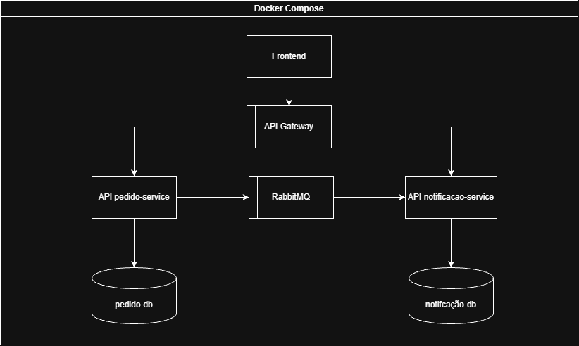

# Sistema Distribuído de Pedidos e Notificações

## 1. Introdução

Este projeto consiste no desenvolvimento de uma aplicação distribuída para gerenciamento de pedidos e processamento de notificações, desenvolvido como parte da disciplina de Computação Distribuída.

A aplicação utiliza uma arquitetura baseada em serviços independentes, que se comunicam por meio de requisições HTTP e troca de mensagens assíncronas. O objetivo é aplicar conceitos de sistemas distribuídos, como comunicação entre processos, processamento assíncrono, separação de responsabilidades, persistência de dados e execução em contêineres.

A infraestrutura foi projetada para ser executada localmente utilizando Docker Compose, dispensando a necessidade de serviços pagos de computação em nuvem.

## 2. Problema e objetivo da aplicação

### 2.1 Problema

Em sistemas de gerenciamento de pedidos, determinadas operações podem exigir o processamento de tarefas adicionais, como o envio de notificações relacionadas à criação de um novo pedido.

Quando todas essas responsabilidades são concentradas em uma única aplicação, o processamento de operações secundárias pode aumentar o acoplamento entre os componentes e afetar o fluxo principal do sistema.

Além disso, a execução de tarefas de forma estritamente síncrona pode fazer com que uma operação principal dependa diretamente da disponibilidade e do tempo de processamento de outros componentes.

Diante desse cenário, o projeto propõe uma arquitetura distribuída na qual o gerenciamento de pedidos e o processamento de notificações são separados, utilizando comunicação assíncrona para permitir que determinadas tarefas sejam executadas independentemente do fluxo principal da aplicação.

### 2.2 Objetivo geral

Desenvolver uma aplicação distribuída para gerenciamento de pedidos e processamento de notificações, utilizando serviços independentes e mecanismos de comunicação síncrona e assíncrona.

### 2.3 Objetivos específicos

- Implementar um serviço responsável pelo gerenciamento de pedidos.

- Implementar um serviço independente para processamento de notificações.

- Utilizar um API Gateway como ponto de entrada para as requisições da aplicação.

- Implementar comunicação síncrona por meio de APIs REST.

- Implementar comunicação assíncrona utilizando RabbitMQ.

- Utilizar bancos de dados para persistência das informações.

- Executar os principais componentes em contêineres Docker.

- Realizar experimentos para observar o comportamento e o desempenho da aplicação distribuída.

- Avaliar o comportamento do sistema diante da falha de um de seus componentes.

## 3. Arquitetura da aplicação

### 3.1 Visão geral

A aplicação utiliza uma arquitetura distribuída baseada na separação de responsabilidades entre diferentes componentes.

O fluxo principal da aplicação começa no cliente, que encaminha suas requisições ao API Gateway. O Gateway direciona as requisições ao serviço responsável pelo gerenciamento dos pedidos.

Após a criação de um pedido, o serviço publica um evento no RabbitMQ. Esse evento poderá ser consumido pelo serviço de notificações, responsável por realizar o processamento correspondente de maneira assíncrona.

A arquitetura proposta é composta pelos seguintes componentes:

- Frontend: interface de interação com o usuário.

- API Gateway: responsável por receber e encaminhar as requisições HTTP.

- pedido-service: responsável pelo gerenciamento dos pedidos.

- notificacao-service: responsável pelo processamento das notificações.

- RabbitMQ: responsável pela comunicação assíncrona entre os serviços.

- pedido-db: banco de dados utilizado pelo serviço de pedidos.

- notificacao-db: banco de dados destinado às informações do serviço de notificações.

### 3.2 Arquitetura



### 3.3 Descrição dos componentes

### API Gateway

O API Gateway funciona como ponto de entrada das requisições HTTP realizadas pelo cliente.

Sua responsabilidade é direcionar as requisições aos serviços correspondentes, evitando que o cliente precise conhecer diretamente os endereços internos de cada serviço.

O componente está configurado para execução na porta 8080.

### pedido-service

O pedido-service é responsável pelas operações relacionadas ao gerenciamento de pedidos.

Entre suas funcionalidades estão:

- Criar novos pedidos.

- Consultar um pedido pelo identificador.

- Listar os pedidos cadastrados.

- Persistir as informações no banco de dados PostgreSQL.

- Publicar eventos relacionados à criação de pedidos no RabbitMQ.

O serviço disponibiliza endpoints REST para realizar essas operações.

### notificacao-service

O notificacao-service será responsável por receber e processar os eventos publicados pelo serviço de pedidos.

Sua comunicação com o pedido-service será realizada por meio do RabbitMQ, permitindo que o processamento das notificações ocorra de maneira assíncrona e independente das requisições HTTP originais.

### RabbitMQ

O RabbitMQ é utilizado como sistema de mensageria da aplicação.

Sua função é intermediar a comunicação assíncrona entre os serviços, permitindo que o produtor publique mensagens sem precisar aguardar diretamente o processamento realizado pelo consumidor.

No projeto, o pedido-service utiliza o mecanismo de publicação de mensagens do RabbitMQ para enviar eventos relacionados à criação de pedidos.

### Persistência de dados

O projeto utiliza PostgreSQL como mecanismo de persistência do serviço de pedidos.

O banco de dados é executado em um contêiner Docker independente, e seus dados são armazenados em um volume persistente denominado pedido-db-data.

A arquitetura prevê a separação dos bancos de dados por serviço, permitindo maior independência entre os componentes.

## 4. Comunicação entre os componentes

A aplicação utiliza dois mecanismos principais de comunicação: comunicação síncrona por HTTP/REST e comunicação assíncrona por mensageria.

### 4.1 Comunicação síncrona

A comunicação síncrona é utilizada entre o cliente, o API Gateway e o serviço de pedidos.

O cliente realiza uma requisição HTTP ao Gateway, que encaminha a solicitação ao serviço responsável pela operação.

Atualmente, o pedido-service disponibiliza os seguintes endpoints:

| Método | Endpoint        | Descrição                              |
|--------|-----------------|----------------------------------------|
| GET    | `/pedidos`      | Lista os pedidos cadastrados           |
| GET    | `/pedidos/{id}` | Consulta um pedido pelo identificador  |
| POST   | `/pedidos`      | Cria um novo pedido                    |

### 4.2 Comunicação assíncrona

A comunicação assíncrona é realizada por meio do RabbitMQ.

Quando um novo pedido é criado, o pedido-service persiste os dados no banco PostgreSQL e publica um evento contendo informações do pedido.

O evento é enviado utilizando:

- Exchange: pedido.exchange

- Routing key: pedido.criado

O objetivo é permitir que o serviço de notificações receba e processe essas informações independentemente do fluxo de criação do pedido.

## 5. Persistência

A persistência dos dados é realizada por meio do PostgreSQL, executado em um contêiner independente.

O serviço de pedidos utiliza o banco pedido-db, cuja porta interna é 5432. Para permitir o acesso a partir da máquina hospedeira, a porta 5433 é disponibilizada externamente.

Os dados são armazenados em um volume Docker, garantindo sua preservação mesmo após a interrupção ou remoção dos contêineres.

A configuração de persistência do serviço de notificações será documentada após sua implementação.

## 6. Execução da aplicação

A infraestrutura utiliza Docker Compose para inicializar e gerenciar os componentes.

A execução é realizada a partir do diretório raiz do projeto:

```cmd
docker compose up --build
```

Para executar os contêineres em segundo plano:

```cmd
docker compose up --build -d
```

Para acompanhar os logs de um serviço:

```cmd
docker compose logs -f pedido-service
```

Para interromper a aplicação:

```cmd
docker compose down
```

A configuração utiliza variáveis de ambiente para definir credenciais e parâmetros de conexão com o banco de dados e o RabbitMQ.

## 7. Experimentos

Esta seção será preenchida após a realização dos experimentos.

Serão realizados dois experimentos relacionados ao funcionamento da aplicação distribuída, sendo pelo menos um quantitativo.

Os experimentos deverão avaliar aspectos como desempenho, concorrência e comportamento da comunicação entre os componentes.

### 7.1 Experimento 1 — Avaliação de desempenho e latência sob diferentes cargas de requisições HTTP.

- Objetivo:
Avaliar quantitativamente o tempo de resposta dos endpoints POST /pedidos e GET /pedidos, expostos pelo API Gateway na porta 8080, sob diferentes volumes de carga e níveis de concorrência, verificando se o fluxo de criação mantém estabilidade enquanto o processamento assíncrono das notificações ocorre em paralelo por meio do RabbitMQ. O experimento busca ainda identificar se existe contenção em recurso compartilhado no acesso ao banco e quantificar seu custo.

- Procedimento:
A aplicação foi executada localmente por meio do Docker Compose, com todos os componentes ativos: API Gateway, pedido-service, notificacao-service, RabbitMQ, pedido-db e notificacao-db.

As medições foram realizadas utilizando um script de teste de carga responsável por enviar requisições HTTP concorrentes ao API Gateway, variando o método HTTP, o volume de requisições e a quantidade de threads.

Antes de cada cenário, foram realizadas dez requisições de aquecimento, cujos resultados foram descartados, visando reduzir interferências relacionadas à inicialização da JVM e ao estabelecimento das conexões com o banco de dados.

Foram executados sete cenários, totalizando 1.550 requisições. Para cada cenário foram registrados os tempos individuais de resposta, a média, a mediana, o percentil 95 (P95), o tempo máximo e a quantidade de erros por código HTTP.

A aplicação é executada localmente via Docker Compose, com todos os componentes ativos: api-gateway, pedido-service, notificacao-service, rabbitmq, pedido-db e notificacao-db. As medições são realizadas por meio de um script que envia requisições HTTP concorrentes ao Gateway, com corpo JSON de estrutura idêntica, variando apenas o identificador de teste. Antes de cada cenário executa-se um aquecimento de dez requisições descartadas, para eliminar o custo de inicialização da JVM e do pool de conexões. Foram executados sete cenários, combinando verbo HTTP, volume e número de threads concorrentes, totalizando 1.550 requisições. Para cada cenário são registrados o tempo individual de cada requisição, do qual se extraem média, mediana, percentil 95 e valor máximo, além da contagem de erros por código de status.

- Resultados:
Os testes apresentaram respostas bem-sucedidas nos cenários avaliados, sem evidências de erros ou indisponibilidade dos serviços.

As requisições POST apresentaram maior tempo de processamento em comparação às requisições GET, devido às operações adicionais de persistência no PostgreSQL e publicação de mensagens no RabbitMQ.

O maior tempo de resposta registrado foi de 372,32 ms, enquanto os valores de P95 permaneceram abaixo de 236 ms em todos os cenários.

No teste de controle, realizado com uma única thread e 50 requisições POST, a latência média foi de 30,14 ms, enquanto no cenário com dez threads foi de 130,93 ms.

- Análise:
- A análise verifica três pontos. Primeiro, as médias de latência caem conforme maior volume é executado, o que não indica ganho de eficiência sob carga, mas aquecimento progressivo do ambiente: compilação JIT da JVM, estabelecimento das conexões físicas do pool e cache de persistência inicialmente vazio. Os valores das rodadas menores superestimam a latência de regime permanente. Segundo, o POST é sistematicamente mais custoso que o GET por executar inserção com commit no PostgreSQL e publicação no RabbitMQ, mas o máximo nunca ultrapassou 372,32 ms e o p95 ficou abaixo de 236 ms em todos os cenários, sem indício de saturação ou degradação em cascata. Terceiro, a rodada de controle com uma única thread isola o custo de contenção: para a mesma carga de 50 POSTs, a média cai de 130,93 ms para 30,14 ms, redução de aproximadamente 4,3 vezes. Como o trabalho por requisição é idêntico, a diferença é atribuída à disputa pelo pool de conexões, cujo tamanho padrão é de 10 conexões, valor igual ao número de threads concorrentes.

- Limitações: A concorrência foi fixada em 10 threads na maior parte dos cenários, com um único baseline sequencial, e a variação principal foi de volume e não de concorrência, de modo que não se traça a curva completa de latência em função da concorrência. Não houve truncamento da tabela entre as rodadas, o que afeta sobretudo o GET, que retorna a coleção completa sem paginação. Não foi instrumentado o consumo de CPU e memória por contêiner. A ordem de execução foi fixa, com rodadas menores antes das maiores, o que confunde aquecimento com volume.

## 8. Experimento de falha

Será realizado um experimento envolvendo a interrupção de um dos componentes da aplicação, com o objetivo de observar como os demais componentes se comportam diante da indisponibilidade de uma parte do sistema.

- Componente interrompido:
- O notificacao-service é interrompido durante a operação normal da aplicação. Em uma segunda etapa do mesmo experimento, o RabbitMQ também é interrompido, para observar o comportamento do pedido-service diante da indisponibilidade do broker de mensagens.

- Procedimento:
- Com a aplicação em operação normal, o contêiner do notificacao-service é parado por meio do comando docker compose stop notificacao-service. Em seguida são criados 50 novos pedidos pelo API Gateway, registrando-se o status HTTP e o tempo de resposta de cada requisição. O estado da fila é consultado via rabbitmqctl list_queues para verificar o acúmulo de mensagens não consumidas. Após esse cenário, o notificacao-service é reiniciado e observa-se o comportamento dos eventos que haviam ficado acumulados. Em uma segunda etapa, o RabbitMQ é parado com docker compose stop rabbitmq, e novas tentativas de criação de pedidos são realizadas, além de consultas e listagens, para verificar quais operações permanecem funcionais.

- Comportamento observado:

- Análise:
com o consumidor parado, 100% dos pedidos foram aceitos com HTTP 201 e latência média de 16,40 ms, inferior à média de 103,61 ms do experimento 1 com tudo ativo. A fila acumulou 50 mensagens e, após o reinício, zerou com 1 consumidor. Nada perdido: a indisponibilidade virou atraso, não perda.

Dependência do broker — com o RabbitMQ parado, 100% dos POSTs deram HTTP 500 e 100% dos GETs deram HTTP 200. A leitura não depende do broker, a escrita depende integralmente. A publicação do evento está dentro da mesma transação que persiste o pedido.

Duas leituras da assimetria — consistência (recusar a escrita evita pedido sem evento correspondente) versus fragilidade (broker como ponto único de falha para toda a escrita).

Mitigações — transactional outbox ou retentativa em segundo plano com espera progressiva.
